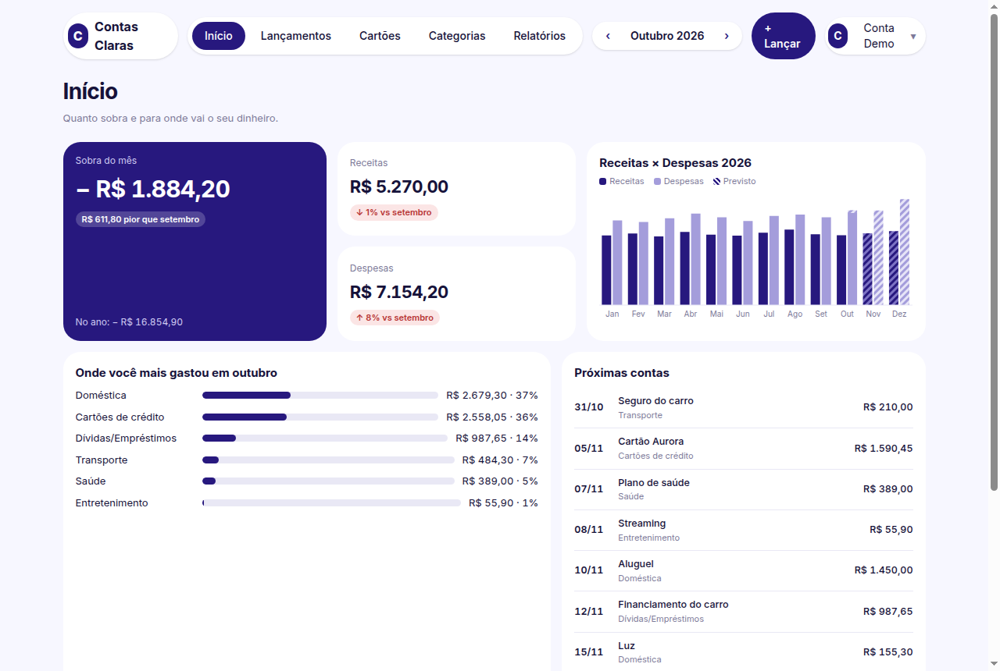
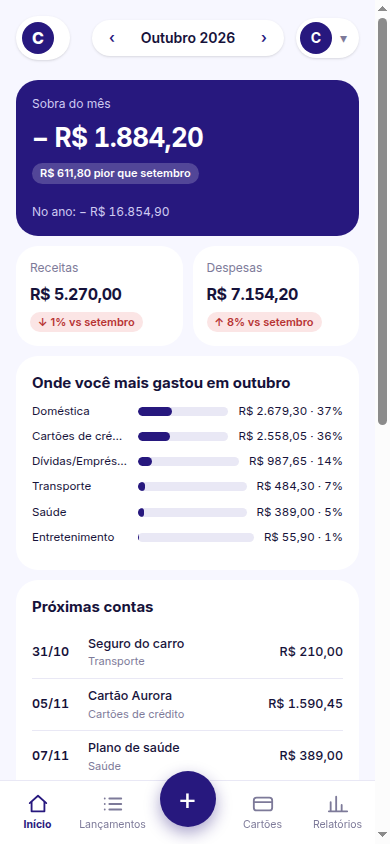
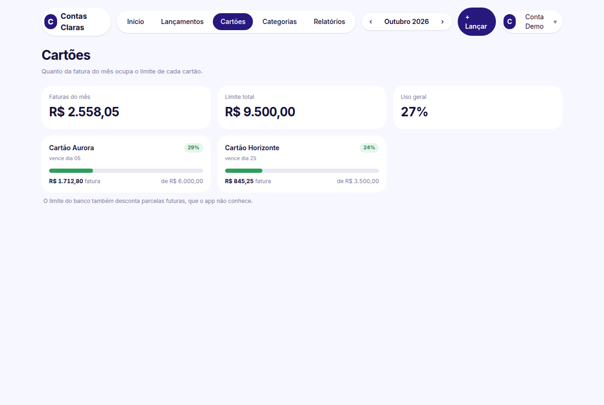
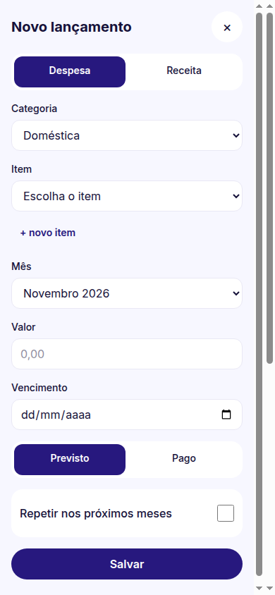
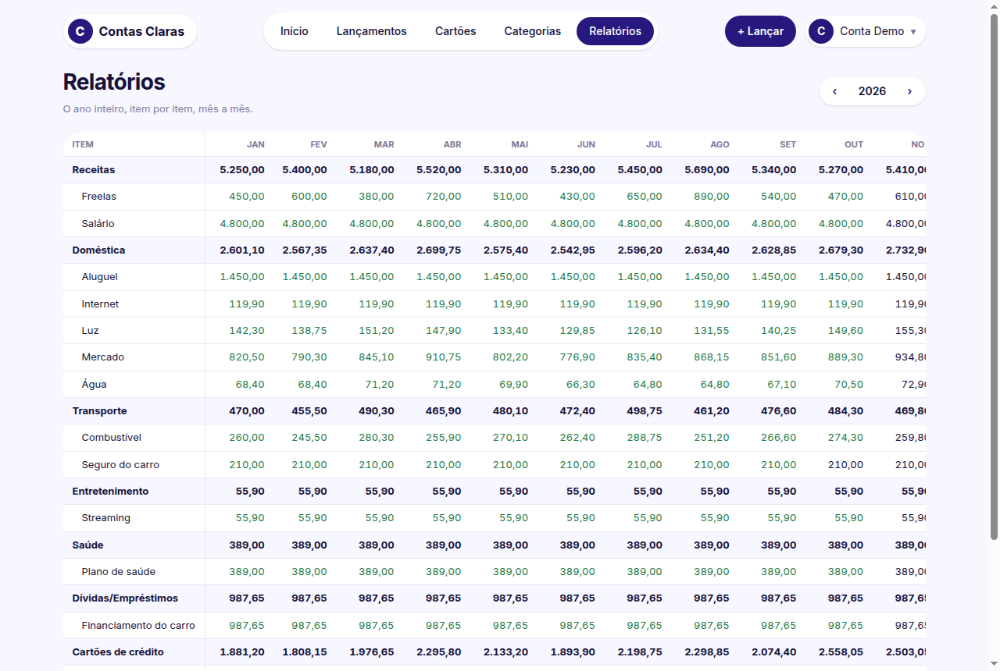
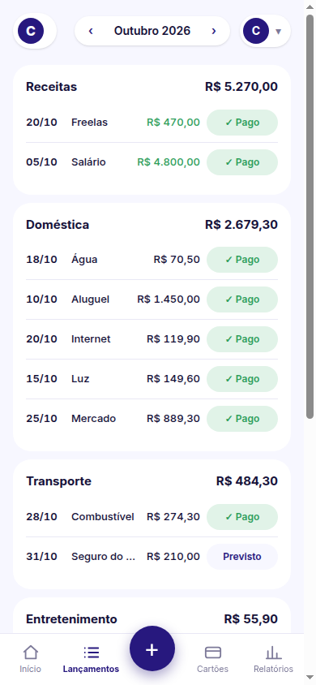
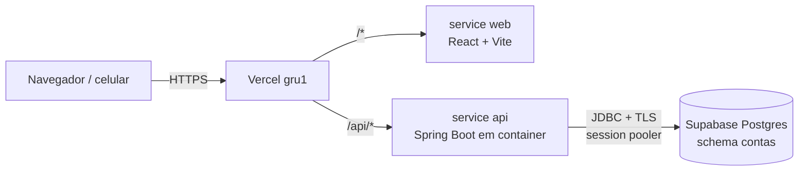

# Contas Claras

Controle financeiro pessoal que substitui uma planilha anual de Excel. Ao abrir, responde duas perguntas: **quanto sobra no mês** e **onde estou gastando mais**. Funciona no computador e no celular, com lançamento rápido, contas previstas e pagas, vencimentos, limites de cartão e uma visão anual no formato da planilha.

**App:** https://contas-claras-ten.vercel.app (cadastro restrito a e-mails liberados)

| Computador | Celular |
|---|---|
|  |  |
|  |  |
|  |  |

*Prints feitos com a conta de demonstração (dados fictícios).*

## Funcionalidades

- **Início:** sobra do mês e do ano, receitas e despesas com comparação ao mês anterior, gráfico do ano (parte prevista listrada), categorias onde mais gastou e próximas contas (com atrasadas).
- **Lançamentos:** categoria → item → valor, um valor por item por mês (como uma célula da planilha), status previsto/pago, vencimento pelo dia padrão do item e "repetir até" para valores fixos.
- **Cartões:** fatura do mês contra o limite de cada cartão, com faixas verde/amarelo/vermelho.
- **Categorias:** criar, renomear, reordenar, arquivar itens, marcar item como cartão e definir limite.
- **Relatórios:** ano inteiro em itens × meses, totais e diferença de caixa, células pagas em verde.
- **Conta:** login por e-mail/senha e Google, cadastro só para e-mails liberados, dados isolados por usuário.
- **Importação:** leitura única da planilha anual (`.xlsx`) para a conta do dono, preservando o status pago (texto verde) e o dia de vencimento `(NN)` dos nomes.

## Stack

| Camada | Tecnologia |
|---|---|
| API | Java 21, Spring Boot 4.1 (Web MVC, Security, OAuth2 Resource Server, Data JPA, Validation), Flyway, Apache POI |
| Banco | PostgreSQL 17 (Supabase em produção) |
| Front | React 19, TypeScript, Vite, Tailwind CSS v4, React Router, TanStack Query, Recharts |
| Testes | JUnit 5, Mockito, Testcontainers · Vitest, Testing Library, MSW |
| Deploy | Vercel Services: front estático + API em container (Container Runtime), região `gru1` |
| CI | GitHub Actions (backend `mvnw verify`, front `test` + `lint` + `build`) |

## Arquitetura



Front e API ficam no **mesmo domínio**, então o cookie de sessão é de primeira parte e não há CORS.

### Decisões técnicas

- **Sessão:** JWT HS256 assinado pela própria API, em cookie `HttpOnly`, `Secure`, `SameSite=Strict`. Nada fica em `localStorage`. Cada token carrega a versão de sessão do usuário: trocar a senha ou vincular o Google invalida todos os tokens antigos.
- **Cadastro restrito:** só e-mails em `ALLOWED_EMAILS`. E-mail fora da lista e e-mail já cadastrado recebem a mesma resposta, para não revelar quem está cadastrado. Login tem limite de 5 tentativas por e-mail a cada 15 minutos, com reserva atômica.
- **Google:** o ID token é validado no backend (audience, `email_verified`). O vínculo por e-mail só acontece em conta sem Google; ele apaga a senha antiga, o que impede alguém de pré-cadastrar o e-mail de outra pessoa.
- **Isolamento:** toda consulta filtra pelo usuário autenticado; recurso de outro usuário responde **404**, nunca 403.
- **Dinheiro:** `BigDecimal` no Java, `numeric(12,2)` no banco e string no JSON (`"1234.56"`). Nada de ponto flutuante.
- **Banco:** migrations Flyway; a FK de lançamento é `ON DELETE RESTRICT`, então apagar categoria nunca apaga lançamento por cascata. Em produção a API usa um role e um schema próprios (`contas`), fora da API REST pública do Supabase.
- **Cold start:** a API escala para zero; o front mostra "Acordando o servidor…" e repete 502/503/504 dentro de uma janela de 90 s.
- **Front:** CSP restrita (só Google Identity Services como origem externa), `X-Frame-Options: DENY`, `nosniff`, redirecionamento pós-login validado contra open redirect.

## Rodar localmente

Pré-requisitos: Java 21, Node 22, Docker.

```bash
docker compose up -d                       # Postgres 17 em 127.0.0.1:5432 (usuário/senha "contas")

cd backend
./mvnw spring-boot:run -Dspring-boot.run.profiles=dev,demo   # API em :8080 + conta demo

cd ../frontend
npm install
npm run dev                                # http://localhost:5173 (proxy /api → :8080)
```

Entre com **demo@contasclaras.dev / demo12345** (perfil `demo`, dados fictícios de 2026).

## Testes

```bash
cd backend && ./mvnw verify                # 243 testes (integração com Testcontainers, precisa de Docker)
cd frontend && npm test -- --run           # 229 testes
cd frontend && npm run lint && npm run build
```

## Importar uma planilha

A planilha precisa seguir o formato anual: abas com o nome do ano, blocos que começam com `JAN` na coluna C, linhas `TOTAL` e bloco `TOTAIS`. A conta de destino precisa existir e estar vazia.

```bash
cd backend && ./mvnw -q -DskipTests package
DATABASE_URL=... DATABASE_USERNAME=... DATABASE_PASSWORD=... JWT_SECRET=... \
java -jar target/contas-claras-0.0.1-SNAPSHOT.jar --spring.profiles.active=importar \
  "--importar.arquivo=/caminho/da/planilha.xlsx" --importar.email=voce@exemplo.com
```

A saída mostra, por ano, receitas, despesas e diferença, para conferir com as linhas TOTAL da planilha.

## Deploy

O `vercel.json` da raiz define os services `web` (`frontend/`) e `api` (`backend/Dockerfile`), as rotas e os headers de segurança. Variáveis de ambiente do projeto na Vercel (modelo em `.env.example`):

`DATABASE_URL`, `DATABASE_USERNAME`, `DATABASE_PASSWORD`, `JWT_SECRET` (≥ 32 bytes), `ALLOWED_EMAILS`, `GOOGLE_CLIENT_ID`, `PORT=8080` e, para o front, `VITE_GOOGLE_CLIENT_ID`.

```bash
vercel deploy --prod
```

## Estrutura

```
backend/    API Spring Boot (pacotes por domínio: auth, categoria, item, lancamento, resumo, cartao, relatorio, importacao)
frontend/   SPA React (paginas/, layout/, auth/, api/, formato/)
docs/       design, plano de implementação e prints
```

O design e o plano usados para construir o projeto estão em [`docs/superpowers/`](docs/superpowers/).
